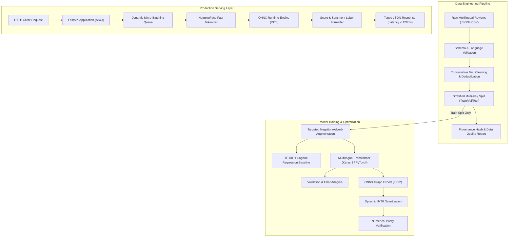

# Architecture Design Document

## 1. System Overview

The **Multilingual Sentiment Classifier for Product Reviews** is an end-to-end machine learning system designed to ingest, normalize, classify, and serve multilingual product reviews across six target languages: English (`en`), German (`de`), Spanish (`es`), French (`fr`), Japanese (`ja`), and Chinese (`zh`).

The architecture strictly adheres to high engineering and MLOps standards:
- **Reproducible data pipeline** with provenance tracking, schema validation, conservative normalization, and leakage-resistant stratified splitting.
- **Dual-model strategy**: a lightweight, deterministic TF-IDF + Logistic Regression linear baseline alongside fine-tuned multilingual transformer models (e.g. `google-bert/bert-base-multilingual-cased` / `xlm-roberta-base`).
- **Dynamic padding and sequence truncation** to optimize throughput and memory utilization.
- **Targeted linguistic data augmentation** (train-split only) addressing negation and sentiment modifiers with empirical before/after validation.
- **Hardware-accelerated inference** via ONNX Runtime with dynamic INT8 quantization.
- **Production REST serving** with FastAPI, Pydantic v2 schemas, asynchronous micro-batching, structured JSON logging, and containerized Docker deployment.

---

## 2. Component Architecture

---

## 3. Module Breakdown

| Directory / Module | Role & Responsibilities |
|---|---|
| `src/sentiment_classifier/config.py` | Centralized typed configuration classes via Pydantic Settings and YAML. |
| `src/sentiment_classifier/data/` | Raw ingestion, Pydantic validation, conservative text normalization, deduplication, and stratified train/val/test splitting. |
| `src/sentiment_classifier/preprocessing/` | Language identification, fast subword tokenization, sequence clipping, and dynamic padding collator. |
| `src/sentiment_classifier/baseline/` | TF-IDF n-gram feature extraction paired with multi-class Logistic Regression with class-weight balancing. |
| `src/sentiment_classifier/training/` | Transformer model instantiation, dynamic padding data loaders, focal/cross-entropy loss, and callbacks. |
| `src/sentiment_classifier/analysis/` | Global & per-language macro-F1/balanced accuracy, confusion matrices, and 10 linguistic failure-mode detectors. |
| `src/sentiment_classifier/optimization/` | ONNX export, dynamic INT8 quantization, and numerical parity assertion (`np.allclose(atol=1e-3)`). |
| `src/sentiment_classifier/inference/` | Asynchronous micro-batching worker, ONNX Runtime session manager, and tokenizer thread safety. |
| `src/sentiment_classifier/api/` | FastAPI REST routes (`/health/live`, `/health/ready`, `/v1/models/metadata`, `/v1/predict`, `/v1/predict/batch`). |

---

## 4. Key Design Decisions

### 4.1 Conservative Text Normalization
Product review sentiment depends critically on punctuation (e.g., `"Great!!!"` vs `"Great???"`), capitalization (`"LOVE IT"`), emojis (`:-(`), and negation particles (`not`, `nicht`, `ne pas`, `tidak`, `不`). Aggressive normalization (such as lowercase-only or stripping non-ASCII characters) discards CJK scripts and destroys emotional nuance. Our normalizer preserves Unicode characters across all supported alphabets while stripping malicious control codes, zero-width spaces, and HTML tags.

### 4.2 Leakage-Resistant Multi-Key Stratified Splitting
Splits are stratified simultaneously across **sentiment class** (`negative`, `neutral`, `positive`) and **language code** (`en`, `de`, `es`, `fr`, `ja`, `zh`). Furthermore, near-duplicate reviews are deduplicated *prior* to splitting to prevent verbatim memorization across train and test sets.

### 4.3 Training-Only Augmentation Guarantee
Data augmentation introduces synthetic linguistic variations (negation inversion, contrastive flips). Applying augmentation to validation or test splits inflates benchmark performance and invalidates honest generalization metrics. The pipeline isolates augmentation exclusively to the training subset.

### 4.4 Dynamic Micro-Batching in API Serving
Rather than processing requests strictly one-by-one or creating unbounded GPU/CPU thread contention, the serving layer incorporates a dynamic batcher that gathers incoming concurrent HTTP requests within a short latency window (e.g. 5–15 ms) up to a max batch size (e.g. 32), executing inference vectorized in ONNX Runtime.
