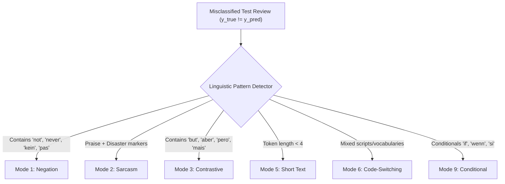

# Error Analysis and Linguistic Failure Modes

## 1. Overview

High aggregate accuracy frequently conceals systematic vulnerabilities on subtle linguistic constructions. Our error analysis engine in `sentiment_classifier.analysis.error_analysis` automatically categorizes model errors across **10 distinct linguistic failure modes**:

1. **Negation Flipping**: Statements where negation alters sentiment polarity (*"not good"*, *"never satisfied"*, *"nicht schlecht"*).
2. **Sarcasm and Irony**: Hyperbolic praise masking negative sentiment (*"Oh great, it broke on day one. Wonderful."*).
3. **Contrastive Discourse**: Sentences conjoined with contrastive markers (*"The display is gorgeous, but the battery died immediately"*).
4. **Mixed Sentiment**: Co-occurrence of equally weighted positive and negative sentiment tokens.
5. **Short Text Ambiguity**: Reviews under 4 tokens (*"Fine"*, *"Okay"*, *"Bad"*).
6. **Code-Switching / Mixed Language**: Reviews combining multiple languages (*"Das Produkt ist really awesome"*).
7. **Adverbial Intensification**: Strong degree modifiers (*"extremely"*, *"barely"*, *"hardly"*).
8. **Spelling and Typography Errors**: Phonetic misspelling, missing spaces, or repeated characters (*"terrrrrible"*, *"loooove"*).
9. **Conditional Expressions**: Counterfactual sentiments (*"Would have been great if it actually worked"*).
10. **Neutral Boundary Collapse**: Ambiguous borderline reviews misclassified as either strong positive or negative.

---

## 2. Failure Mode Taxonomy & Detection Logic

---

## 3. Targeted Remediation Strategies

| Failure Mode | Root Cause in Bag-of-Words / Baselines | Transformer Mitigation Strategy |
|---|---|---|
| **Negation** | Unigram tokenization decouples negation particle from adjective (`"not"` + `"good"`). | Transformer self-attention attends to token spans; targeted augmentation injects balanced negation pairs. |
| **Sarcasm** | Vocabulary matches positive sentiment distribution. | Contextual representation across sentence clauses; fine-tuning on sarcasm-annotated subsets. |
| **Contrastive** | Bag-of-words sums positive and negative word scores equally. | Positional encoding and attention heads weight the recency and importance of the post-contrast clause. |
| **Short Text** | Sparse feature vector lacks distinctive n-grams. | Subword embeddings leverage semantic proximity to anchor tokens. |

Detailed breakdown of discovered errors is saved automatically to `artifacts/reports/error_analysis_report.json`.
